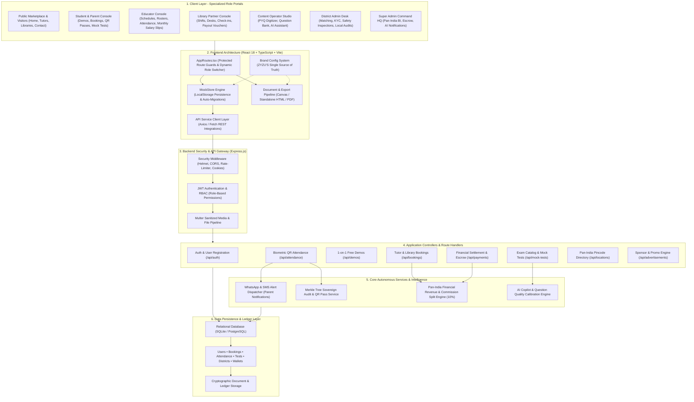

# ZYZU'S — Tutors & Libraries (ZYZU-S)

> **"I HAVE DESIGNED THIS APP FOR THE FUTURE"**  

> **India's Premier District-Supervised Education Utility Network**  
> Connecting learners with verified 1-on-1 home tutors, air-conditioned self-study libraries, CBT government exam test series, and digital learning vaults.

---

## 📌 Executive Summary

**ZYZU'S** (formerly FocusPoint) is an enterprise-grade education platform engineered for transparent, district-administered academic operations across Uttar Pradesh and India. Rather than operating as an unverified open classified directory, ZYZU'S enforces rigorous **District Administration oversight**, automated identity verification, shift-based facility reservations, and tamper-evident cryptographic ledgers.

### 🏛️ Core Platform Differentiators
- **District Coordinator Matching**: Eliminates public phone number scraping and unsolicited spam. District Admins evaluate syllabus, location, and student grade to match exactly one thoroughly vetted educator.
- **Accredited Study Sanctuaries**: Direct integration with physical self-study libraries featuring multi-shift reservation (Morning, Evening, Full Day, 24/7), power backup audits, and biometric QR turnstile tracking.
- **CBT Examination & PYQ Vault**: Computer-Based Testing (CBT) engine replicating NTA/UPPSC patterns, featuring bilingual support, AI-assisted question calibrations, and an automated Student Mistake Book.
- **Sovereign Financial Clearinghouse**: Transparent 10% platform service fee, escrow-backed fee protection, automated educator salary slips, and instant digital invoicing.

---

## 🏢 Official Headquarters & Communications Desk

- **Headquarters Address**: Saidpur, Ghazipur 233304, Uttar Pradesh, India
- **Postal Zone / Coordinates**: PIN `233304` • GPS `25.5458° N, 83.2195° E`
- **Primary Mobile Helpline**: `+91 91964 34387` (Voice Calling & WhatsApp Concierge)
- **Secondary Helpline & Escalations**: `+91 95696 44387`
- **Official Administrative Email**: `focuspoint011@gmail.com` (Secondary: `support@zyzus.com`)
- **Web Portal**: [https://zyzus.com](https://zyzus.com) • Verification Node: [https://zyzus.com/verify/doc](https://zyzus.com/verify/doc)
- **Operating Hours**: Monday – Saturday: 08:00 AM – 09:00 PM IST

---

## 🏗️ Architecture & Pipeline Flowchart



---

## 🎯 Role-Based Portals & Modules

| Portal | Route Prefix | Key Responsibilities |
| :--- | :--- | :--- |
| **Public Marketplace** | `/`, `/tutors`, `/libraries`, `/contact` | Discovery of verified home educators, library directory with shift timings, pricing calculators, and cyber-telemetry contact desk. |
| **Student & Parent Console** | `/student/*` | Booking management, instant demo passes, live QR attendance passport, CBT test center, mistake workbook, and unified document repository. |
| **Educator Console** | `/teacher/*` | Profile accreditation, timetable scheduling, student rosters, monthly attendance logs, and verified monthly salary slips. |
| **Library Owner Studio** | `/library-owner/*` | Desk inventory, shift allocation (Morning/Evening/Night/24H), walk-in vs online check-ins, monthly payout vouchers, and partnership accreditation certificates. |
| **Content Operator Studio** | `/operator/*` | PYQ digitizer studio, central question bank management, exam catalog blueprints, AI Copilot authoring, and audit trails. |
| **District Admin Desk** | `/district-admin/*` | Local educator KYC verification, tutor-student matching, physical library inspections, attendance anomaly resolution, and district expense vouchers. |
| **Super Admin Command HQ** | `/super-admin/*` | Pan-India district governance, GMV & financial reconciliation (10% platform share), WhatsApp automated broadcast center, and cryptographic ledger inspection. |

---

## 🛠️ Technology Stack

- **Frontend**:
  - **Framework**: React 18 with TypeScript
  - **Build Tool**: Vite 5
  - **Styling**: TailwindCSS with bespoke glassmorphic tokens
  - **Routing**: React Router DOM v6 with role-based route guards
  - **Icons**: Lucide React
  - **Rendering & Export**: High-resolution HTML5 Canvas & standalone HTML print renderer for official receipts, salary slips, and ID cards
- **Backend**:
  - **Runtime**: Node.js
  - **Framework**: Express.js
  - **Security**: Helmet, CORS, Cookie-Parser, Express-Rate-Limit
  - **Authentication**: JWT (JSON Web Tokens) with bcrypt password hashing
  - **File Uploads**: Multer with strict MIME and executable-script sanitization
- **Databases**:
  - **Local/Embedded**: `better-sqlite3` with foreign-key enforcement
  - **Production Adapter**: PostgreSQL (`pg`)
- **Testing**:
  - Vitest test runner (81 / 81 test files passing, 1,106+ unit and integration tests)

---

## 📂 Project Directory Structure

```text
focuspoint-platform/
├── frontend/                     # React + TypeScript + Vite Application
│   ├── src/
│   │   ├── components/           # Shared UI (Cards, Inputs, Modals, Navbar, Footer)
│   │   ├── config/               # Brand standards (brand.ts, logo assets, tokens)
│   │   ├── context/              # AuthContext, ToastContext
│   │   ├── features/             # Feature slices by portal:
│   │   │   ├── auth/             # Login, Student/Teacher/Owner registration
│   │   │   ├── booking/          # Tuition & Library booking workflows
│   │   │   ├── district-admin/   # District command, teacher approvals, matching
│   │   │   ├── documents/        # MyDocumentsPage, Ledger document cards
│   │   │   ├── library-owner/    # Desk management, shifts, payouts
│   │   │   ├── operator/         # PYQ studio, question bank, test authoring
│   │   │   ├── public/           # HomePage, FindTutor, FindLibrary, ContactPage
│   │   │   ├── student/          # Dashboard, CBT tests, QR pass, subscriptions
│   │   │   ├── super-admin/      # Multi-district oversight, revenue analytics
│   │   │   └── teacher/          # Timetable, attendance, salary slips
│   │   ├── mock/                 # In-browser reactive store & seed data
│   │   ├── routes/               # AppRoutes.tsx, ProtectedRoute.tsx
│   │   ├── services/             # REST API service clients (api.ts, revenue, audit)
│   │   ├── types/                # TypeScript interface definitions
│   │   └── utils/                # documentExportUtils.ts, storageUtils.ts
│   ├── package.json
│   └── vite.config.ts
├── src/                          # Express.js Backend API
│   ├── config/                   # Brand & environment configurations (brand.js)
│   ├── controllers/              # REST endpoint business logic
│   ├── database/                 # SQLite/Postgres schemas, migrations & seeds
│   ├── middleware/               # Auth, role-gating, uploads, error handling
│   ├── routes/                   # Modular Express routers
│   ├── scripts/                  # DB seed and migration scripts
│   ├── services/                 # Autonomous background services (WhatsApp, Audit)
│   ├── app.js                    # Express app initialization
│   └── server.js                 # HTTP server bootstrap
├── tests/                        # Vitest backend integration test suite
├── package.json                  # Root scripts & dependencies
└── README.md
```

---

## ⚡ Quickstart Guide

### Prerequisites
- **Node.js**: v18.0.0 or higher
- **npm**: v9.0.0 or higher

### 1. Installation
Install root backend and frontend dependencies:
```bash
# Clone the repository
git clone https://github.com/your-org/focuspoint-platform.git
cd focuspoint-platform

# Install backend dependencies
npm install

# Install frontend dependencies
npm --prefix frontend install
```

### 2. Environment Setup
Create a `.env` file in the root directory:
```env
PORT=3000
NODE_ENV=development
JWT_SECRET=your_super_secret_jwt_key_2026
FRONTEND_URL=http://localhost:5173
```

### 3. Database Seeding
Seed initial districts, roles, demo users, question bank items, and sample libraries:
```bash
npm run seed
```

### 4. Running Development Servers
Run both backend and frontend servers:
```bash
# Terminal 1: Backend Express Server (http://localhost:3000)
npm run dev

# Terminal 2: Frontend Vite Server (http://localhost:5173)
npm run frontend:dev
```

### 5. Running the Test Suite
Run the full Vitest suite (81 test files):
```bash
npm test
```

### 6. Production Frontend Build
Compile TypeScript and generate the production bundle:
```bash
npm run frontend:build
```

---

## ⚖️ Legal & Brand Continuity

**ZYZU'S** operates under **ZYZU'S EdTech Private Limited** *(formerly FocusPoint EdTech Private Limited)*. All trademarks, digital ledgers, accreditation seals, and verification hashes are protected under applicable Indian regulatory laws.

- **Copyright**: © 2026 ZYZU'S — Tutors & Libraries. All rights reserved.
- **Support & Inquiries**: `focuspoint011@gmail.com` • `+91 91964 34387`
